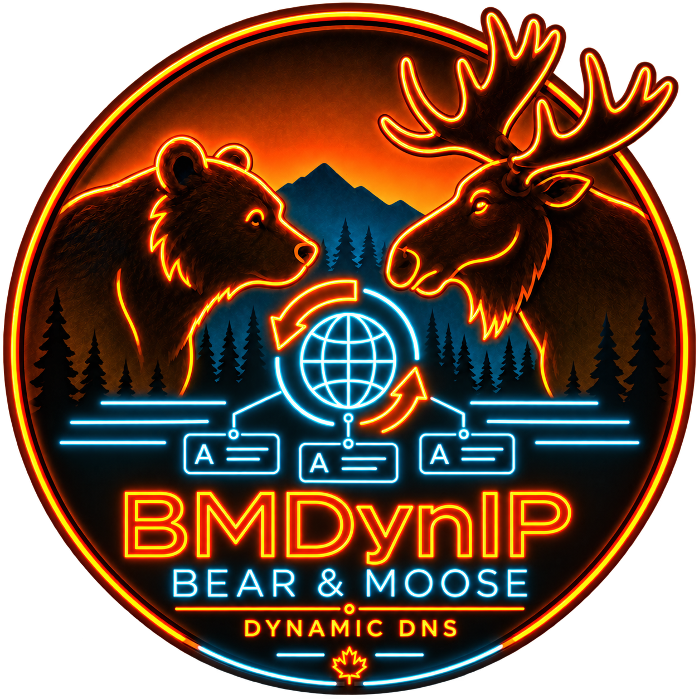
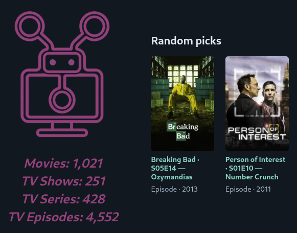
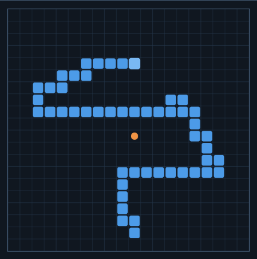
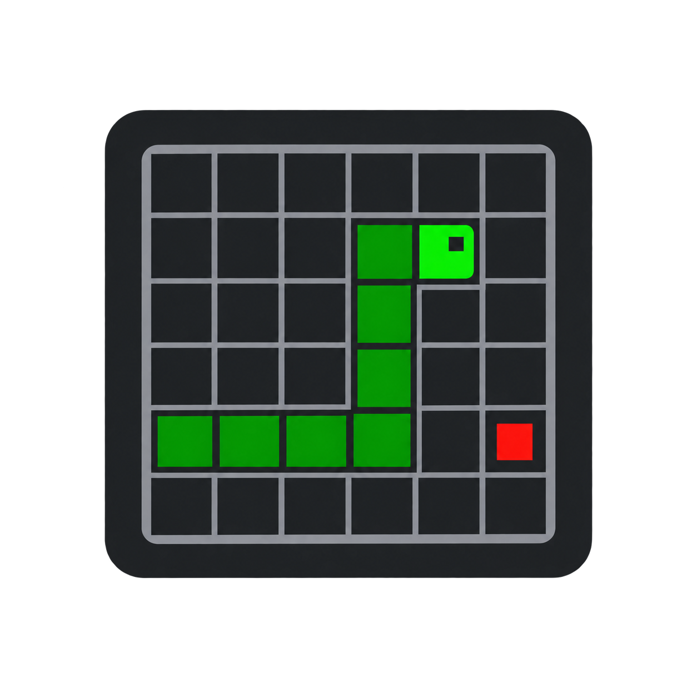
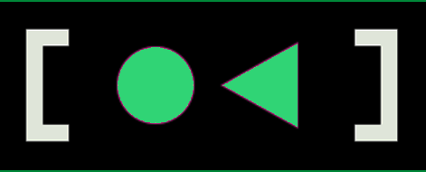

## Open Source Projects

<table aria-label="Open source projects">
  <tbody>
    <tr>
      <td align="center" valign="top" width="20%">
        
<b><i>AI Dev Skillset</i></b>

        <a href="https://bmforge.osoyalce.com">
          
           
          <b>BMForge</b>
        </a>
        
<a href="https://github.com/NadimGhaznavi/bmforge">GitHub Repo</a>

      </td>
      <td align="center" valign="top" width="20%">
        
<b><i>Website Analytics</i></b>

        <a href="https://mycount.osoyalce.com">
          
           
          <b>MyCount</b>
        </a>
        
<a href="https://github.com/NadimGhaznavi/mycount">GitHub Repo</a>

      </td>
      <td align="center" valign="top" width="20%">
        
<b><i>Disk Replication</i></b>

        <a href="https://diskha.osoyalce.com">
          
           
          <b>DiskHA</b>
        </a>
        
<a href="https://github.com/NadimGhaznavi/disk-ha">GitHub Repo</a>

      </td>
      <td align="center" valign="top" width="20%">
        
<b><i>Dynamic DNS</i></b>

        <a href="https://bmdynip.osoyalce.com">
          
           
          <b>BMDynIP</b>
        </a>
        
<a href="https://github.com/NadimGhaznavi/bmdynip">GitHub Repo</a>

      </td>
      <td align="center" valign="top" width="20%">
        
<b><i>GeoIP Database</i></b>

        <a href="https://bmgeoip.osoyalce.com">
          
           
          <b>BMGeoIP</b>
        </a>
        
<a href="https://github.com/NadimGhaznavi/bmgeoip">GitHub Repo</a>

      </td>
    </tr>
    <tr>
      <td align="center" valign="top" width="20%">
        
<b><i>Media Organizer</i></b>

        <a href="https://r3el.osoyalce.com">
          
           
          <b>R3el</b>
        </a>
        
<a href="https://github.com/NadimGhaznavi/r3el">GitHub Repo</a>

      </td>
      <td align="center" valign="top" width="20%">
        
<b><i>Live Ax3l Data</i></b>

        <a href="https://snakeweb.osoyalce.com">
          
           
          <b>Ax3l Live</b>
        </a>
        
<a href="https://github.com/NadimGhaznavi/snake-web-code">GitHub Repo</a>

      </td>
      <td align="center" valign="top" width="20%">
        
<b><i>Local LLM Experiment</i></b>

        <a href="https://ax3l.osoyalce.com">
          
           
          <b>Ax3l</b>
        </a>
        
<a href="https://github.com/NadimGhaznavi/ax3l">GitHub Repo</a>

      </td>
      <td align="center" valign="top" width="20%">
        
<b><i>Simulation Server</i></b>

        <a href="https://snakelabserver.osoyalce.com">
          
           
          <b>Snake Lab Server</b>
        </a>
        
<a href="https://github.com/NadimGhaznavi/snake-lab">GitHub Repo</a>

      </td>
      <td align="center" valign="top" width="20%">
        
<b><i>Certificate Authority</i></b>

        <a href="https://bmca.osoyalce.com">
          
           
          <b>BMCA</b>
        </a>
        
<a href="https://github.com/NadimGhaznavi/bmca">GitHub Repo</a>

      </td>
    </tr>
    <tr>
      <td align="center" valign="top" width="20%">
        
<b><i>AI RL Sandbox</i></b>

        <a href="https://ai-hydra.readthedocs.io/en/latest/">
          
           
          <b>AI Hydra</b>
        </a>
        
<a href="https://github.com/NadimGhaznavi/ai_hydra">GitHub Repo</a>

        
<a href="https://pypi.org/project/ai-hydra/">PyPI Package</a>

      </td>
      <td align="center" valign="top" width="20%">
        
<b><i>AI RL Sandbox</i></b>

        <a href="https://snakelab.osoyalce.com/">
          
           
          <b>AI Snake Lab</b>
        </a>
        
<a href="https://github.com/NadimGhaznavi/ai_snake_lab">GitHub Repo</a>

        
<a href="https://pypi.org/project/ai_snake_lab/">PyPI Package</a>

      </td>
      <td align="center" valign="top" width="20%">
        
<b><i>Systemctl Wrapper</i></b>

        <a href="https://systemctl.osoyalce.com/">
          
           
          <b>SystemCtl</b>
        </a>
        
<a href="https://github.com/NadimGhaznavi/systemctl">GitHub Repo</a>

        
<a href="https://pypi.org/project/systemctl/">PyPI Package</a>

      </td>
      <td align="center" valign="top" width="20%">
        
<b><i>Delphi POC</i></b>

        <a href="https://delphi.osoyalce.com/">
          
           
          <b>Addressbook</b>
        </a>
        
<a href="https://github.com/NadimGhaznavi/systemctl">GitHub Repo</a>

      </td>
      <td align="center" valign="top" width="20%"></td>
    </tr>
  </tbody>
</table>

